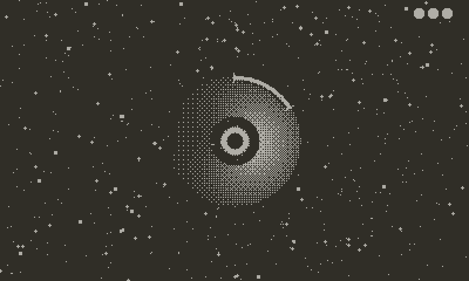
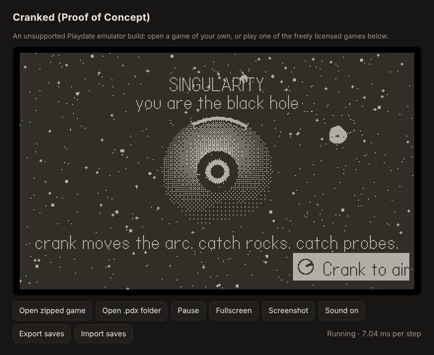
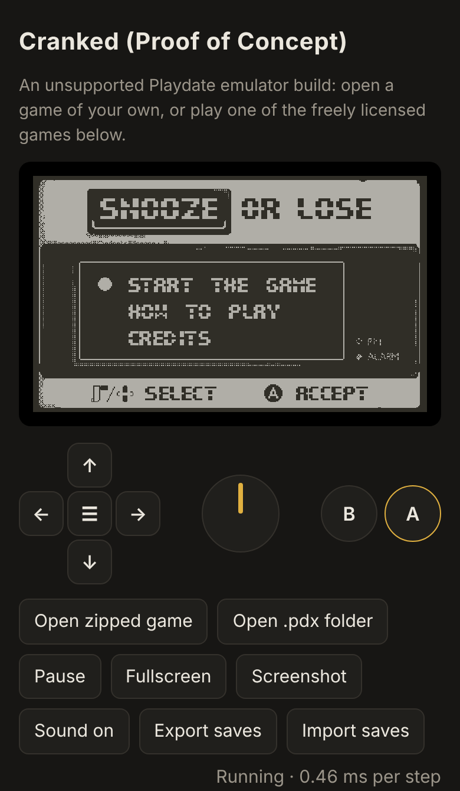
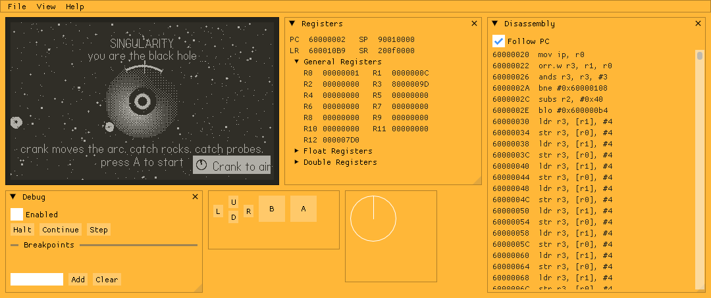

# Cranked Proof of Concept

[](https://github.com/TheLogicMaster/Cranked-PoC/actions/workflows/build.yml)
[](https://thelogicmaster.github.io/Cranked-PoC/)

A **Proof of Concept** build of [Cranked](https://github.com/TheLogicMaster/Cranked), the Playdate emulator, brought
much closer to the behaviour of the Playdate SDK 3.1.1 Simulator and of the device (OS 3.1.2).

> **Unsupported.** This is a one-off release. It will not receive support or updates. Cranked will be implemented
> again from scratch using what was learned here, which is written up in the
> [Cranked APIs](https://github.com/TheLogicMaster/Cranked-APIs) repository (how the Playdate APIs behave, with the
> test programs that show it).
>
> **AI-written.** The patches, scripts and documentation here were written by an AI system under the maintainer's
> direction; see [NOTICE.md](NOTICE.md).

<p align="center"></p>

**[Play it in the browser](https://thelogicmaster.github.io/Cranked-PoC/)**: the web build, with a catalog of freely
licensed games and the Playdate SDK's examples, or any game of your own (nothing is uploaded; games and saves stay in
your browser).

- **Lua and C games**: C games run on Unicorn's JIT on the desktop, or on the built-in ARM interpreter where a JIT is
  not possible (the browser, iOS, consoles).
- **Front ends**: a desktop app (Windows, macOS, Linux; also as an AppImage and a Flatpak) with a debugger, a libretro
  core (RetroArch; an Android build is experimental), and the browser build (installable, works offline, touch and gamepad controls).
- **Much closer to the real thing**: hundreds of behaviours measured against the SDK 3.1.1 Simulator and fixed; see
  [Cranked APIs](https://github.com/TheLogicMaster/Cranked-APIs).

| The web build | On a phone | The desktop app's debugger |
| --- | --- | --- |
|  |  |  |

The games shown are [Singularity](https://github.com/Rani367/singularity) by Rani367 (MIT) and
[Snooze or Lose](https://github.com/britalmeida/project_snooze) by Team Snooze (CC0).

## What is here

| Path | What it is |
| --- | --- |
| `cranked.commit` | The Cranked commit the patches apply to |
| `scripts/fetch-cranked.sh` | Clones Cranked at that commit (with its submodules) into `cranked/` and applies the patches |
| `patches/` | The changes, as a patch series (`series` lists the order and where each applies) |
| `scripts/apply-patches.sh` | Applies the series to `cranked/` (and its submodules); safe to run again |
| `scripts/prepare-sdk-assets.sh` | Copies and compiles the SDK assets the build embeds (fonts, crank indicator, keyboard) |
| `scripts/make-standin-assets.py` | Draws the plain stand-ins that replace all but the fonts in builds to distribute |
| `scripts/build.sh` | Applies the patches, prepares the assets, and builds the targets below into `dist/` |
| `scripts/make-site.sh` | Assembles the hosted web site from the web build and `site/` |
| `scripts/wrap-game.sh` | Wraps a game and the desktop front end into one executable, a macOS app or an AppImage |
| `scripts/package-linux.sh` | AppImage and Flatpak of the desktop front end |
| `scripts/docker-build.sh`, `docker/` | The same builds in Docker, with your SDK passed in |
| `packaging/` | The Flatpak manifest, desktop entry, icon, the libretro core's RetroArch info file, and the optional download proxy (`download-proxy/`) |
| `site/` | The hosted site's settings (`site.json`), the games it hosts (`games.tsv`) and the games it links to (`links.tsv`) |
| `docs/screenshots/` | The pictures in this file |
| `.github/workflows/` | Builds every target on Linux, Windows and macOS, and publishes the web build to the `gh-pages` branch |

The Playdate SDK is not included. Its assets are taken from your own copy of SDK 3.1.1 at build time.

## Building

```
git clone <this repository> cranked-poc
cd cranked-poc
scripts/build.sh --sdk /path/to/PlaydateSDK-3.1.1 desktop libretro web
```

`build.sh` runs `scripts/fetch-cranked.sh` first, which clones Cranked at the commit in `cranked.commit` into
`cranked/` (once) and applies the patches; the built targets land in `dist/<target>/`. To get the patched sources
without building, run `scripts/fetch-cranked.sh` alone.

A build made this way embeds the SDK's own crank indicator, keyboard images and system sounds, and is for your own
use only. For a build you will hand out, set `SDK_ASSETS=fonts`:

```
SDK_ASSETS=fonts scripts/build.sh --sdk /path/to/PlaydateSDK-3.1.1 desktop libretro web
```

Only the Playdate fonts (CC BY 4.0) are then taken from the SDK. The other SDK assets, and Cranked's own older copies
in `core/resources` (`crank-frames*.pdt`, `crank-notice-*.pdi`, `menu-*.pdi`, `bounce.pda`), are replaced by plain
stand-ins with the same names, sizes, frame counts and audio formats, drawn by `scripts/make-standin-assets.py` and
compiled with your SDK's `pdc`. `build.sh` passes `--distributable` to `scripts/prepare-sdk-assets.sh` for this
(`prepare-sdk-assets.sh [--distributable] <SDK folder> [cranked folder]` runs it alone), and prepares the assets
again whenever `SDK_ASSETS` changes, so the SDK is needed then too. The CI workflow always builds this way. See
NOTICE.md.

Targets:

| Target | Result |
| --- | --- |
| `desktop` | The SDL desktop front end (Windows, macOS, Linux), C games through Unicorn's JIT |
| `desktop-nojit` | The same with the ARM interpreter (no JIT) |
| `libretro` | A libretro core (RetroArch and other frontends), with the JIT |
| `libretro-nojit` | A libretro core with the interpreter, for platforms that forbid JIT (iOS, consoles) |
| `libretro-android` | The libretro core for Android (arm64 by default, interpreter; needs the Android NDK) |
| `appimage` | A Linux AppImage of the desktop front end (needs appimagetool); written to `dist/packages/` |
| `web` | The browser front end (Emscripten 3.1.52 or later; set `EMSDK` or put `emcc` on the PATH) |
| `runner` | The headless test runner (prints a game's console output; used to compare against the Simulator) |

### In Docker

```
scripts/docker-build.sh --sdk /path/to/PlaydateSDK-3.1.1 web desktop desktop-nojit libretro libretro-nojit appimage
```

This builds the image in `docker/` (Ubuntu 24.04 with the compilers, CMake, Ninja, Emscripten 3.1.52 and
appimagetool), mounts this folder and your SDK (read-only), and runs `build.sh` in it as you; the results land in
`dist/` as usual (`SDK_ASSETS` is passed on). Give it the Linux SDK: its `pdc` compiles the assets the build embeds (needed once). Add
`libretro-android` for the Android core: the image is then built with the Android NDK (`ANDROID=1`, about 2 GB
more). Windows and macOS builds need their own systems (the CI workflow has them).

### Without Docker

Needs CMake 3.20 or later, a C++20 compiler (GCC 13, Clang 17 or MSVC 2022), Python 3, and Ninja (optional). On
Linux the desktop front end needs the SDL2 development files. CMake downloads one dependency (asio) when it
configures; offline, pass `CMAKE_EXTRA="-DCPM_asio_SOURCE=/path/to/asio"`.

## The desktop front end

`cranked_desktop [game]` opens a game given on the command line, or none: File > Open (a `.pdx` folder or a zipped
game), File > Recent, or dropping a game on the window. The player view fills the window with the screen (View >
Player view turns it off for the debugger's windows). Keys: arrows, Z or A for B, X or S for A, Enter for the menu,
`,` and `.` or the mouse wheel for the crank, C to dock it, F11 fullscreen, F1 the menu bar. Gamepads: d-pad or left
stick, the right face button for A and the bottom one for B, Start or Back for the menu, the right stick or the
shoulder buttons for the crank. Save data goes to `./appData` when that folder exists, else the user's data folder
(`--data <folder>` picks another).

`scripts/wrap-game.sh <cranked_desktop> <game> <output>` makes a game into one thing to hand out: a single
executable (the zipped game appended to it), a macOS `.app`, or an AppImage, by the output's name. The wrapped game
starts at once, fills the window, and keeps its saves in the user's data folder. `scripts/package-linux.sh` makes an
AppImage and a Flatpak of the emulator itself. Only wrap games whose licenses allow it.

## Hosting the web build

`dist/web` is a static site: serve it over HTTP (HTTPS for the offline and audio worklet features). It works in two
ways:
- **A library** (the default): players open their own games (a zipped `.pdx`, a `.pdx` folder, or dropped on the
  screen), which are kept in the browser (IndexedDB) with their save data. A `games.json` next to the page adds a
  list of games to download and play; `scripts/make-site.sh` builds it from `site/games.tsv`, which must only list
  games whose licenses allow redistribution.
- **One game**: `?game=<address of a zipped .pdx>` in the URL, or `"game"` in a `site.json` next to the page, starts
  that game at once and hides the library and file pickers.

Games from other web sites can be opened with `?game=<address>` only when that site allows it (CORS): GitHub release
downloads and itch.io do not, while files in a GitHub repository served through jsDelivr
(`https://cdn.jsdelivr.net/gh/<owner>/<repo>@<tag>/<file>.pdx.zip`) do. The hosted site avoids the problem by copying
its games next to the page: `scripts/make-site.sh` downloads the games in `site/games.tsv` at build time, and with
`--sdk-examples <SDK>` also builds the SDK's example games, Lua and C (the C ones for the device, when
arm-none-eabi-gcc is installed; the web build runs them on its ARM interpreter); each carries a BSD Zero Clause
license.

Games that cannot be hosted (their licenses cover only the code, say) go in `site/links.tsv`: the catalog lists them
with a "Get it" link to the author's page, where players download the game and then open it here. An entry can also
give a direct download, which the catalog fetches through an optional download proxy (`packaging/download-proxy`, a
Cloudflare Worker that only fetches the downloads in the site's own list); a proxy still passes on a copy, so only
for games that may be redistributed.

`site.json` (optional) can also set `"title"`, `"subtitle"`, `"catalog"` (the game list's address) and `"proxy"`. Players can
export a game's save data as a zip and import it again. Gamepads (standard mapping), keyboard and touch work.

The workflow publishes the site (`scripts/make-site.sh`) to the `gh-pages` branch; turn on GitHub Pages for that
branch in the repository settings. It also uploads the finished site as the `cranked-poc-site` artifact. To make and
try the site locally (the page must be served over HTTP, not opened as a file):

```
scripts/make-site.sh --sdk-examples /path/to/PlaydateSDK-3.1.1 dist/web public
python3 -m http.server -d public 8000      # then open http://localhost:8000/
```

The C examples are only built when `arm-none-eabi-gcc` is installed.

## What changed

The changes are in `patches/`. In short:
- hundreds of API behaviours measured against the Simulator and fixed (graphics, sprites, collisions, text, audio,
  files, JSON, the C API's calling conventions);
- an ARM interpreter, so C games run without a JIT (in the browser, or where JIT is not allowed);
- the browser front end, the libretro core and the desktop front end made usable.

The behaviours themselves, and the test programs behind them, are documented in Cranked APIs rather than here.

## License

MIT, as Cranked (see `LICENSE`). Games are not included and remain their authors'.

This Proof of Concept was written by an AI system (Anthropic's Claude) under the direction of Cranked's maintainer,
and it is not a contribution to Cranked (whose rules do not accept AI-generated code). Comments that describe "the
device" come from analysis of its software, not from tests on a physical Playdate. See [NOTICE.md](NOTICE.md) for
what this means for copyright, for the SDK assets the build uses, and for the Panic and Playdate trademarks.
Playdate is a trademark of Panic Inc.; this project is not affiliated with Panic.
