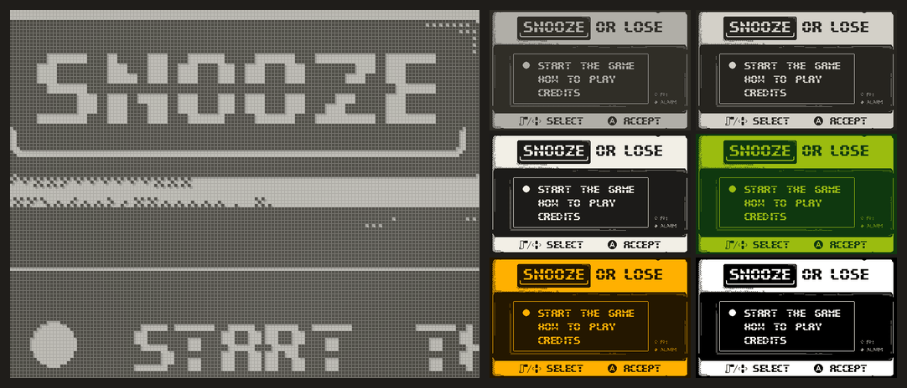
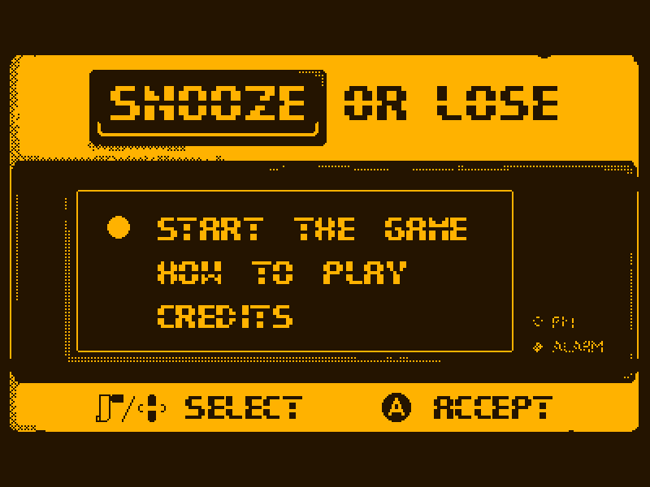

# Cranked Proof of Concept

[](https://github.com/TheLogicMaster/Cranked-PoC/actions/workflows/build.yml)
[](https://thelogicmaster.github.io/Cranked-PoC/)

A **Proof of Concept** build of [Cranked](https://github.com/TheLogicMaster/Cranked), the Playdate emulator, brought
much closer to the behaviour of the Playdate SDK 3.1.1 Simulator and of the device (OS 3.1.2).

> **Unsupported.** This is a one-off release. It will not receive support or updates. Cranked will be implemented
> again from scratch using what was learned here, which is written up in the
> [Cranked APIs](https://github.com/TheLogicMaster/Cranked-APIs) repository (how the Playdate APIs behave, with the
> test programs that show it).
>
> **AI-written.** The patches, scripts and documentation here were written by an AI system under the maintainer's
> direction; see [NOTICE.md](NOTICE.md).

<p align="center"></p>

**[Play it in the browser](https://thelogicmaster.github.io/Cranked-PoC/)**: the web build, with a catalog of freely
licensed games and the Playdate SDK's examples, or any game of your own (nothing is uploaded; games and saves stay in
your browser).

- **Lua and C games**: C games run on Unicorn's JIT on the desktop, or on the built-in ARM interpreter where a JIT is
  not possible (the browser, iOS, consoles).
- **Front ends**: a desktop app (Windows, macOS, Linux; also as an AppImage and a Flatpak) with a debugger, a libretro
  core (RetroArch; an Android build is experimental), an Android app (experimental), a DOS build (experimental), and the browser build (installable, works offline, touch and gamepad controls).
- **The screen's look**: color presets, blending of flickered pixels into grey, the LCD's pixel grid and shadow, room
  light, scanlines, and a drawn Playdate whose buttons light up and whose crank turns, in every front end (see
  [The screen's look](#the-screens-look)).
- **Much closer to the real thing**: hundreds of behaviours measured against the SDK 3.1.1 Simulator and fixed; see
  [Cranked APIs](https://github.com/TheLogicMaster/Cranked-APIs).

| The web build | On a phone | The desktop app's debugger |
| --- | --- | --- |
|  |  |  |

| The screen's look | The DOS build |
| --- | --- |
|  |  |

The games shown are [Singularity](https://github.com/Rani367/singularity) by Rani367 (MIT) and
[Snooze or Lose](https://github.com/britalmeida/project_snooze) by Team Snooze (CC0).

## What is here

| Path | What it is |
| --- | --- |
| `cranked.commit` | The Cranked commit the patches apply to |
| `scripts/fetch-cranked.sh` | Clones Cranked at that commit (with its submodules) into `cranked/` and applies the patches |
| `patches/` | The changes, as a patch series (`series` lists the order and where each applies) |
| `scripts/apply-patches.sh` | Applies the series to `cranked/` (and its submodules); safe to run again |
| `scripts/prepare-sdk-assets.sh` | Copies and compiles the SDK assets the build embeds (fonts, crank indicator, keyboard) |
| `scripts/make-standin-assets.py` | Draws the plain stand-ins that replace all but the fonts in builds to distribute |
| `scripts/build.sh` | Applies the patches, prepares the assets, and builds the targets below into `dist/` |
| `scripts/make-site.sh` | Assembles the hosted web site from the web build and `site/` |
| `scripts/wrap-game.sh` | Wraps a game and the desktop front end into one executable, a macOS app or an AppImage |
| `scripts/package-linux.sh` | AppImage and Flatpak of the desktop front end |
| `scripts/docker-build.sh`, `docker/` | The same builds in Docker, with your SDK passed in |
| `android/` | The Android app (Gradle project; the native library comes from `scripts/build.sh android`) |
| `scripts/build-djgpp.sh`, `scripts/build-hdpmi.sh` | The DJGPP cross compiler and the HDPMI32 DPMI host for the DOS build |
| `packaging/` | The DOS build's README and batch file (`dos/`), the Flatpak manifest, desktop entry, icon, the libretro core's RetroArch info file, and the optional download proxy (`download-proxy/`) |
| `site/` | The hosted site's settings (`site.json`), the games it hosts (`games.tsv`) and the games it links to (`links.tsv`) |
| `docs/screenshots/` | The pictures in this file |
| `.github/workflows/` | Builds the targets on Linux, Windows and macOS, publishes the web build to the `gh-pages` branch, and makes releases; it runs when started by hand (Actions > build > Run workflow), with a checkbox per target |

The Playdate SDK is not included. Its assets are taken from your own copy of SDK 3.1.1 at build time.

## Building

```
git clone <this repository> cranked-poc
cd cranked-poc
scripts/build.sh --sdk /path/to/PlaydateSDK-3.1.1 desktop libretro web
```

`build.sh` runs `scripts/fetch-cranked.sh` first, which clones Cranked at the commit in `cranked.commit` into
`cranked/` (once) and applies the patches; the built targets land in `dist/<target>/`. To get the patched sources
without building, run `scripts/fetch-cranked.sh` alone.

A build made this way embeds the SDK's own crank indicator, keyboard images and system sounds, and is for your own
use only. For a build you will hand out, set `SDK_ASSETS=fonts`:

```
SDK_ASSETS=fonts scripts/build.sh --sdk /path/to/PlaydateSDK-3.1.1 desktop libretro web
```

Only the Playdate fonts (CC BY 4.0) are then taken from the SDK. The other SDK assets, and Cranked's own older copies
in `core/resources` (`crank-frames*.pdt`, `crank-notice-*.pdi`, `menu-*.pdi`, `bounce.pda`), are replaced by plain
stand-ins with the same names, sizes, frame counts and audio formats, drawn by `scripts/make-standin-assets.py` and
compiled with your SDK's `pdc`. `build.sh` passes `--distributable` to `scripts/prepare-sdk-assets.sh` for this
(`prepare-sdk-assets.sh [--distributable] <SDK folder> [cranked folder]` runs it alone), and prepares the assets
again whenever `SDK_ASSETS` changes, so the SDK is needed then too. The CI workflow always builds this way. See
NOTICE.md.

Targets:

| Target | Result |
| --- | --- |
| `desktop` | The SDL desktop front end (Windows, macOS, Linux), C games through Unicorn's JIT |
| `desktop-nojit` | The same with the ARM interpreter (no JIT) |
| `libretro` | A libretro core (RetroArch and other frontends), with the JIT |
| `libretro-nojit` | A libretro core with the interpreter, for platforms that forbid JIT (iOS, consoles) |
| `libretro-android` | The libretro core for Android (arm64 by default, interpreter; needs the Android NDK r26 or later) |
| `android` | The Android app, `dist/android/Cranked-PoC.apk` (arm64 by default, interpreter; needs the Android NDK r26 or later and the SDK, and JDK 17; Gradle comes through `android/gradlew`; not in Docker) |
| `dos` | The DOS front end, `dist/dos/CRANKED.EXE` with the HDPMI32 DPMI host (interpreter; needs DJGPP with GCC 13 or later in `DJGPP_PREFIX`, default `~/djgpp`, which `scripts/build-djgpp.sh` builds; not in Docker) |
| `appimage` | A Linux AppImage of the desktop front end (needs appimagetool); written to `dist/packages/` |
| `web` | The browser front end (Emscripten 3.1.52 or later; set `EMSDK` or put `emcc` on the PATH) |
| `runner` | The headless test runner (prints a game's console output; used to compare against the Simulator) |

### In Docker

```
scripts/docker-build.sh --sdk /path/to/PlaydateSDK-3.1.1 web desktop desktop-nojit libretro libretro-nojit appimage
```

This builds the image in `docker/` (Ubuntu 24.04 with the compilers, CMake, Ninja, Emscripten 3.1.52 and
appimagetool), mounts this folder and your SDK (read-only), and runs `build.sh` in it as you; the results land in
`dist/` as usual (`SDK_ASSETS` is passed on). Give it the Linux SDK: its `pdc` compiles the assets the build embeds (needed once). Add
`libretro-android` for the Android core: the image is then built with the Android NDK (`ANDROID=1`, about 2 GB
more). Windows and macOS builds need their own systems (the CI workflow has them).

### Without Docker

Needs CMake 3.20 or later, a C++20 compiler (GCC 13, Clang 17 or MSVC 2022), Python 3, and Ninja (optional). On
Linux the desktop front end needs the SDL2 development files. CMake downloads one dependency (asio) when it
configures; offline, pass `CMAKE_EXTRA="-DCPM_asio_SOURCE=/path/to/asio"`.

## The desktop front end

`cranked_desktop [game]` opens a game given on the command line, or none: File > Open (a `.pdx` folder or a zipped
game), File > Recent, or dropping a game on the window. The player view fills the window with the screen (View >
Player view turns it off for the debugger's windows). Keys: arrows, Z or A for B, X or S for A, Enter for the menu,
`,` and `.` or the mouse wheel for the crank, C to dock it, F11 fullscreen, F1 the menu bar. Gamepads: d-pad or left
stick, the right face button for A and the bottom one for B, Start or Back for the menu, the right stick or the
shoulder buttons for the crank. Save data goes to `./appData` when that folder exists, else the user's data folder
(`--data <folder>` picks another).

`scripts/wrap-game.sh <cranked_desktop> <game> <output>` makes a game into one thing to hand out: a single
executable (the zipped game appended to it), a macOS `.app`, or an AppImage, by the output's name. The wrapped game
starts at once, fills the window, and keeps its saves in the user's data folder. `scripts/package-linux.sh` makes an
AppImage and a Flatpak of the emulator itself. Only wrap games whose licenses allow it.

## The screen's look

`core/ScreenEffects` (in the patches) draws the screen for the front ends, on the CPU (the screen is 400x240 at one bit
a pixel, so even at 3x it is cheap: about 1.5 ms a frame for the drawn device in the browser):

| Effect | What it does |
| --- | --- |
| Colors | Playdate (the default), bright room, paper, Game Boy, amber, high contrast |
| Blend frames | Mixes each frame with the one before, as the eye does with pixels a game flickers to make grey (it smears motion, so it is off by default) |
| Pixel grid, pixel shadow | The gaps between the LCD's pixels, and the faint shadow dark pixels cast on the reflector behind them (2x and up) |
| Room light | A lamp's sheen on the screen; a phone's tilt (browser) or the emulated accelerometer (desktop) moves it |
| Scanlines | A CRT's scanlines and aperture grille: a novelty, since the Playdate never had a CRT (2x and up) |
| Device frame | The screen inside a drawn Playdate, whose buttons light up when pressed and whose crank turns (it is not clickable) |

Where they are: the desktop app's Screen menu; the browser build's Screen panel (kept in the browser); the libretro
core's options (colors, blending, the LCD look or scanlines, room light, the device frame, and 2x or 3x for the effects
that need it; RetroArch's own LCD and CRT shaders work on the plain screen as well); and in the DOS build, colors and
blending (`-c <n>` and `-b`, or F2 and F3 while playing). The DOS build blends through the VGA's palette: a second
plane holds the frame before.

## The Android app

`android/` is a small Android app (plain Java, no libraries) around Cranked's JNI binding (`java/` in Cranked):
`scripts/build.sh android` builds the native library for each ABI in `ANDROID_ABIS` into
`android/app/src/main/jniLibs/` and then the APK with Gradle. The release APK is signed with the debug key, so it
installs as is (`adb install dist/android/Cranked-PoC.apk`); sign it with your own key to publish it. Android 7.0
(API 24) or later.

The app opens a zipped game (`.pdx.zip`, or a zip of a `.pdx` folder) from the system file picker, or one another app
opens or shares with it, and reopens the last game on the next start. Games and their save data are kept in the
app's own storage. The Back button opens the app menu (open a game, restart it, show or hide the touch controls,
quit). Touch controls: a d-pad on the left, B and A on the right, the menu button in the top-left corner, and the
crank, a wheel on the right that turns with the finger (double-tap it to dock or undock the crank). Gamepads and
keyboards map as on the desktop. C games run on the ARM interpreter, as in the libretro core for Android.

## The DOS build

`scripts/build.sh dos` builds `CRANKED.EXE`, a 32-bit protected mode DOS program (DJGPP), and puts it in `dist/dos/`
with `HDPMI32.EXE` (the HX DOS extender's DPMI host, freeware, built from source by `scripts/build-hdpmi.sh`),
`CRANK.BAT`, which starts the host and then Cranked, `DOSBOX-X.CONF`, the DOSBox-X settings to run it with, and a
`README.TXT` for the user. The compiler is GCC 14.2 for
DJGPP, which `scripts/build-djgpp.sh [folder]` builds with [jwt27/build-gcc](https://github.com/jwt27/build-gcc)
(about half an hour; the prebuilt DJGPP releases are too old for `<format>`).

It needs a Pentium or later and a VGA: the screen is shown at twice its size in the VESA 800x600 16-color mode, or
at its own size in 640x480 (`-1`). A Sound Blaster 16 named by `BLASTER` plays the sound, and a mouse driver lets
the mouse turn the crank. Keys are those of the desktop front end, plus P to pause, F2 for the next colors, F3 to
blend frames, F5 to restart, F12 for a screenshot and Esc to quit (`-c <0-5>` and `-b` set the colors and blending
from the start). Games are opened from the command line (`CRANK game.zip`); a long file name driver
(DOSLFN) is recommended, since save data go into folders named after bundle IDs. C games run on the ARM
interpreter, so even a recent PC booted into DOS runs only light ones at full speed (the SDK's Life example runs
about 34 million ARM instructions a frame, and the interpreter does about 5 million a second in DOSBox-X on a modern
host); Lua games are lighter, and simple ones run at full speed in DOSBox-X. `CRANKED_LOG=<file>` writes the log
and the game's console output to a file.

In DOSBox-X, where it is tested, run `dosbox-x -conf DOSBOX-X.CONF` in the folder: it becomes drive C:. The
settings that matter are more memory than the default 16 MB, full speed, long file names (DOSBox-X reports DOS 5,
so its "auto" leaves them off) and no prompt for a working folder (a first run asks, and the snap's folder picker
can fail); the rest are DOSBox-X's defaults, written out.

## Making a release

Run the workflow by hand (Actions > build > Run workflow) with the targets to include ticked, **Release** ticked
and a **Version** such as `v0.2` (or `v0.2-rc1`; tick **Pre-release** to mark it as one). The version is checked
first: a malformed one, or one that is already a tag or a release, stops the run before anything is built. When
the builds are done, the release job tags the commit the run built with the version and publishes a release named
"Cranked PoC <version>" with GitHub's list of changes since the previous release. If the Linux, Windows, macOS,
Flatpak or web build fails, nothing is released; the experimental ones (Android, the Android libretro core, DOS) are
left out when they fail.

`scripts/package-release.sh` turns the builds into the release's files, and runs on artifacts downloaded by hand
too:

| File | What it is |
| --- | --- |
| `Cranked-PoC-x86_64.AppImage`, `Cranked-PoC-x86_64.flatpak` | The Linux desktop app, packaged |
| `Cranked-PoC-linux-x86_64.zip`, `Cranked-PoC-windows-x64.zip` | The desktop app and the libretro cores, each with the JIT and as the interpreter build (`-nojit`) |
| `Cranked-PoC-macOS.zip`, `Cranked-PoC-macOS-libretro.zip` | The macOS app, and the libretro cores |
| `Cranked-PoC-web.zip` | The web build, to host (see below) |
| `Cranked-PoC.apk`, `Cranked-PoC-android-libretro.zip` | The Android app, and the libretro core for Android |
| `Cranked-PoC-dos.zip` | The DOS build |

## Hosting the web build

`dist/web` is a static site: serve it over HTTP (HTTPS for the offline and audio worklet features). It works in two
ways:
- **A library** (the default): players open their own games (a zipped `.pdx`, a `.pdx` folder, or dropped on the
  screen), which are kept in the browser (IndexedDB) with their save data. A `games.json` next to the page adds a
  list of games to download and play; `scripts/make-site.sh` builds it from `site/games.tsv`, which must only list
  games whose licenses allow redistribution.
- **One game**: `?game=<address of a zipped .pdx>` in the URL, or `"game"` in a `site.json` next to the page, starts
  that game at once and hides the library and file pickers.

Games from other web sites can be opened with `?game=<address>` only when that site allows it (CORS): GitHub release
downloads and itch.io do not, while files in a GitHub repository served through jsDelivr
(`https://cdn.jsdelivr.net/gh/<owner>/<repo>@<tag>/<file>.pdx.zip`) do. The hosted site avoids the problem by copying
its games next to the page: `scripts/make-site.sh` downloads the games in `site/games.tsv` at build time, and with
`--sdk-examples <SDK>` also builds the SDK's example games, Lua and C (the C ones for the device, when
arm-none-eabi-gcc is installed; the web build runs them on its ARM interpreter); each carries a BSD Zero Clause
license.

Games that cannot be hosted (their licenses cover only the code, say) go in `site/links.tsv`: the catalog lists them
with a "Get it" link to the author's page, where players download the game and then open it here. An entry can also
give a direct download, which the catalog fetches through an optional download proxy (`packaging/download-proxy`, a
Cloudflare Worker that only fetches the downloads in the site's own list); a proxy still passes on a copy, so only
for games that may be redistributed.

`site.json` (optional) can also set `"title"`, `"subtitle"`, `"catalog"` (the game list's address) and `"proxy"`. Players can
export a game's save data as a zip and import it again. Gamepads (standard mapping), keyboard and touch work.

The workflow publishes the site (`scripts/make-site.sh`) to the `gh-pages` branch when run with Web and Publish checked; turn on GitHub Pages for that
branch in the repository settings. It also uploads the finished site as the `cranked-poc-site` artifact. To make and
try the site locally (the page must be served over HTTP, not opened as a file):

```
scripts/make-site.sh --sdk-examples /path/to/PlaydateSDK-3.1.1 dist/web public
python3 -m http.server -d public 8000      # then open http://localhost:8000/
```

The C examples are only built when `arm-none-eabi-gcc` is installed.

## What changed

The changes are in `patches/`. In short:
- hundreds of API behaviours measured against the Simulator and fixed (graphics, sprites, collisions, text, audio,
  files, JSON, the C API's calling conventions);
- an ARM interpreter, so C games run without a JIT (in the browser, or where JIT is not allowed);
- the browser front end, the libretro core and the desktop front end made usable;
- the screen's look (colors, frame blending, the LCD's grid and shadow, room light, scanlines, a drawn device) for
  every front end;
- a DOS front end and the changes for building with DJGPP (where `int32_t` is `long`, and a few C99 math and
  `<fenv.h>` functions are missing).

The behaviours themselves, and the test programs behind them, are documented in Cranked APIs rather than here.

## License

MIT, as Cranked (see `LICENSE`). Games are not included and remain their authors'.

This Proof of Concept was written by an AI system (Anthropic's Claude) under the direction of Cranked's maintainer,
and it is not a contribution to Cranked (whose rules do not accept AI-generated code). Comments that describe "the
device" come from analysis of its software, not from tests on a physical Playdate. See [NOTICE.md](NOTICE.md) for
what this means for copyright, for the SDK assets the build uses, and for the Panic and Playdate trademarks.
Playdate is a trademark of Panic Inc.; this project is not affiliated with Panic.
